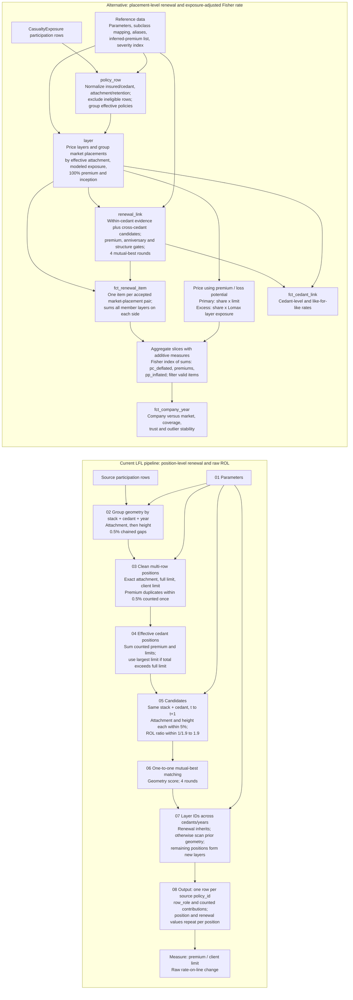

# LFL Logic Comparison

This diagram compares the current LFL pipeline with the alternative placement-level monitor. It assumes both start from the same source population; source filters and data-quality exclusions are intentionally omitted from the comparison.

## What the diagram highlights

- **Renewal unit:** A matches an effective cedant position within the same stack. B matches a market placement and can accept cross-cedant renewals.
- **Order:** A matches positions before assigning longitudinal layer IDs. B first builds same-year market placements, then links placements across years.
- **Cross-cedant role:** A's geometry scan can carry a layer ID but is not itself an accepted renewal. B's cross-cedant candidate can be an accepted market-placement renewal.
- **Rate measure:** A reports raw premium per client limit. B adjusts price for modeled loss-potential changes, then uses a Fisher aggregation for valid renewal items.
- **Output grain:** A's published detail is one row per source policy, with repeated position-level fields. B publishes placement items, cedant links and company-year summaries as separate grains.

The alternative's severity-index values in the supplied specification are all 1.0, so its exposure adjustment is structural, not an applied inflation adjustment. Both methods use chained-neighbour grouping, but their grouping keys, fields and tolerances differ.
